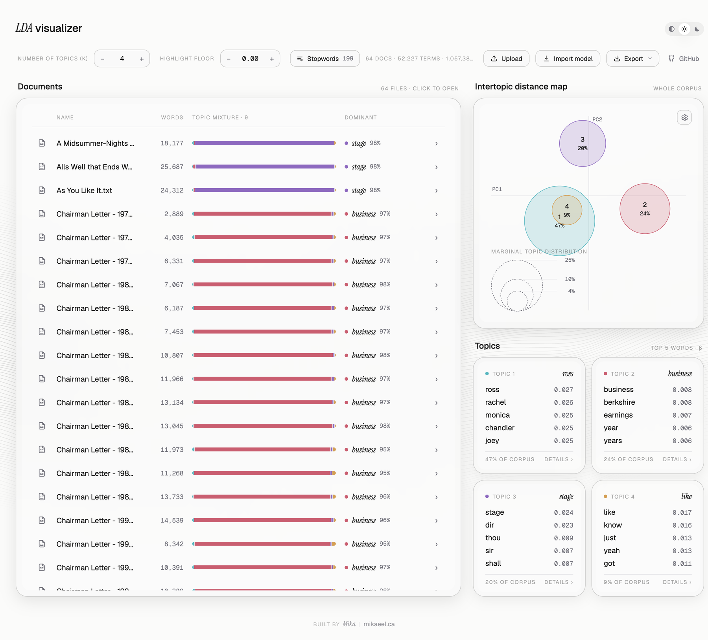
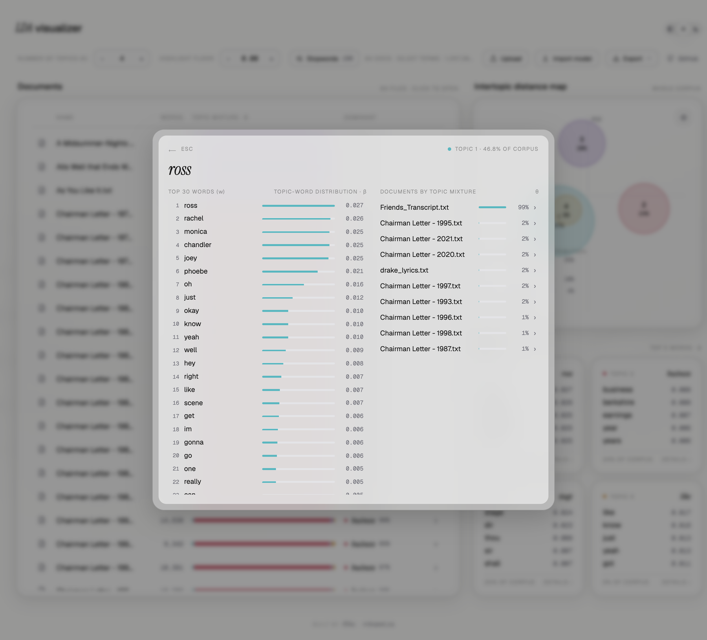
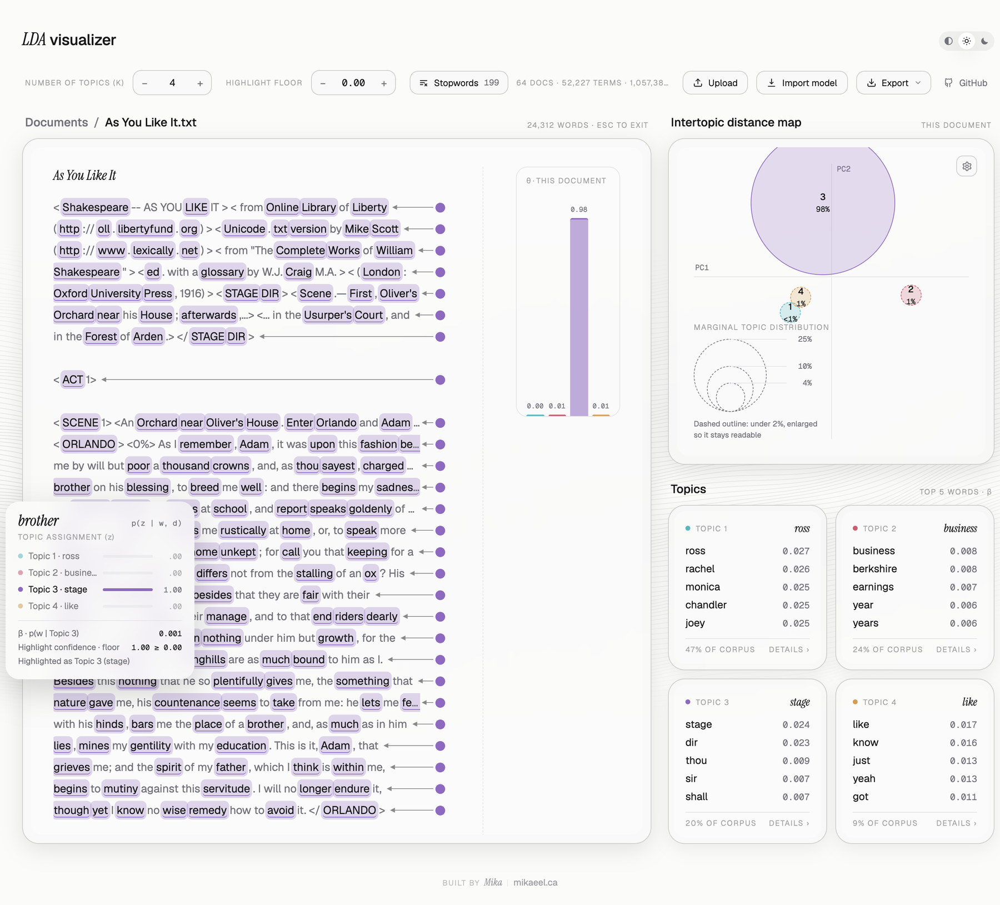
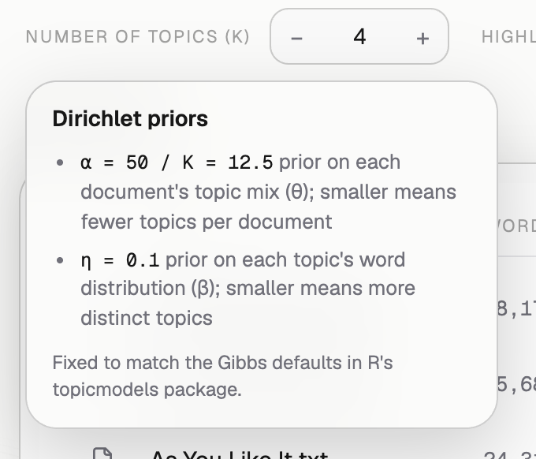

# LDA visualizer

Interactive LDA topic model visualizer that runs entirely in the browser.

**Live:** [lda-visualizer.mikaeel.ca](https://lda-visualizer.mikaeel.ca/)

Upload plain-text documents and the page fits a Latent Dirichlet Allocation
model locally, or import a model you already fitted in R or Python. Nothing is
sent to a server.

<picture>
  <source media="(prefers-color-scheme: dark)" srcset="docs/screenshots/overview-dark.png">
  
</picture>

The screenshots use the article's training corpus at K = 4: 64 documents from four Kaggle datasets (17 Shakespeare plays, 45 Berkshire Hathaway chairman's letters, a Friends transcript and a Drake lyrics file). Each source ends up as its own topic.

## Notation

The labels in the app follow the notation used in the accompanying article:

| Symbol | Meaning | Where it appears |
|---|---|---|
| *V* | Number of unique words in the corpus | Corpus summary in the toolbar ("terms") |
| *w* | A word in a document | Topic detail modal ("Top 30 words (w)"), document view |
| *K* | Number of topics, chosen before fitting | **Number of topics (K)** control |
| *z* | The topic assigned to an individual word | Word tooltip in the document view: **Topic assignment (z)**, p(z \| w, d) |
| β | Topic-word distribution, p(w \| z) | Numbers on the topic cards and in the topic detail modal |
| θ | Topic mixture: each topic's share of a document | **Topic mixture · θ** bars, the document view's bar chart, the topic detail modal |
| α | Dirichlet prior on the topic mixtures (θ) | Tooltip on the K control |
| η | Dirichlet prior on the topic-word distributions (β) | Tooltip on the K control |

Some libraries use other letters for the same quantities. R's `topicmodels`
calls the β prior `delta`, and much of the literature writes the topic-word
distribution as φ. The JSON model format keeps the key `phi` for β.

## Features

- **Fit in the browser:** collapsed Gibbs sampling in plain JavaScript
  (K = 2–20, seed 1, α = 50 / K, η = 0.1, 500 sweeps). These match the Gibbs
  defaults in R's `topicmodels`.
- **Preprocessing:** lower-casing; punctuation, numbers and symbols removed;
  an editable stopword list (defaults to quanteda's English list plus
  every single letter).
- **Explore:** topic cards with each topic's top words and their β values; an
  intertopic distance map; each document's topic mixture (θ); and a document
  view that colours every word by its most likely topic assignment (z).
- **Import:** models from R (`topicmodels`) or Python (scikit-learn, gensim).
- **Export:** document-topic (θ) and topic-word (β) CSVs, the model as JSON,
  or a single self-contained HTML page you can host or embed in an iframe.
- Light and dark themes; `.txt`, `.md`, `.csv` and `.zip` uploads.

## Reading the views

**Topics.** Each card shows a topic's five most probable words with their β
values, p(w | z). These are the same in every document. The footer gives the
topic's share of all tokens in the corpus. Topics are numbered by that share,
so Topic 1 is the largest. Click a card for its top 30 words and the documents
whose topic mixture (θ) leans on it most.

<picture>
  <source media="(prefers-color-scheme: dark)" srcset="docs/screenshots/topic-detail-dark.png">
  
</picture>

**Intertopic distance map.** One bubble per topic, so there are always *K*.
Bubble size is the topic's share of the corpus. Position reflects how similar
the topics' word distributions are: topics that share many words sit close
together or overlap. The article notes that LDA maps commonly use principal
component analysis (PCA). This map follows
[LDAvis](https://github.com/cpsievert/LDAvis) instead: it measures the
Jensen–Shannon divergence between topics and projects it to two dimensions
with classical multidimensional scaling (principal coordinates, hence the
PC1/PC2 axes).

**Document view.** Click a document to read it with each word highlighted in
its most likely topic. Hover a word to see its topic assignment (z):
p(z | w, d) ∝ θ<sub>d</sub> × β, so the same word can lean towards different
topics in different documents. The **Highlight floor** hides highlights the
model is unsure about. The bar chart shows the document's topic mixture (θ).

<picture>
  <source media="(prefers-color-scheme: dark)" srcset="docs/screenshots/document-view-dark.png">
  
</picture>

**Priors.** Hover **Number of topics (K)** to see the Dirichlet priors used
for fitting in the browser. A smaller α means each document covers fewer
topics. An imported model keeps whatever priors it was fitted with.

<picture>
  <source media="(prefers-color-scheme: dark)" srcset="docs/screenshots/priors-tooltip-dark.png">
  
</picture>

## Usage

Open `index.html` in a modern browser (Chrome, Edge, Safari or Firefox),
then click **Upload** or drop files anywhere on the page. One file is one
document.

Or use the hosted version at
[lda-visualizer.mikaeel.ca](https://lda-visualizer.mikaeel.ca/), which
deploys automatically from `main`.

To host your own copy, serve `index.html` and `favicon.png` from any static
host. No backend is needed.

LDA needs enough text to find stable topics. As the article suggests, it works
best with many documents (100 or more) that are at least article length. With
only a few short files the topics blur together, because α = 50 / K is large
compared with each document's word count.

## Importing a model from R or Python

1. Fit your model, then run the matching exporter:
   - R: [`export_for_toolkit.R`](export_for_toolkit.R). It uses the variable
     names from the article's R script (`lda_model`, `document_dfm`,
     `document_list`), so you can run it straight after that script.
   - Python: `export_sklearn(...)` or `export_gensim(...)` in
     [`export_for_toolkit.py`](export_for_toolkit.py)
2. In the page, click **Import model** and choose the resulting
   `lda_model.json`. If you left the texts out of the JSON, select the `.txt`
   files together with it to get the per-word document view.

The same snippets are available inside the app's Import model dialog.

## Development

`index.html` is a self-unpacking bundle: fonts, React, the page runtime and
the one design-system component the page uses (the animated background) are
embedded. The page itself lives in [`src/template.html`](src/template.html).
Edit that file, then rebuild:

```bash
python3 build.py
```

## Credits

- [React](https://react.dev) (MIT)
- [Geist](https://vercel.com/font) and
  [Instrument Serif](https://fonts.google.com/specimen/Instrument+Serif)
  fonts (SIL Open Font License 1.1)
- The intertopic distance map follows the approach of
  [LDAvis](https://github.com/cpsievert/LDAvis) (Sievert & Shirley, 2014)

## License

[MIT](LICENSE)
